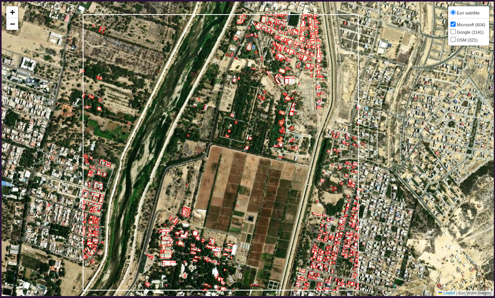
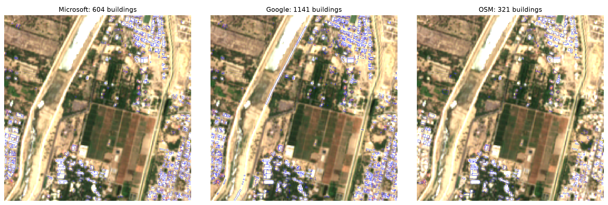
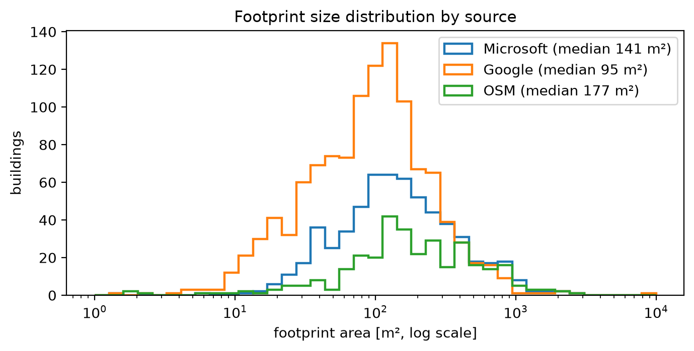
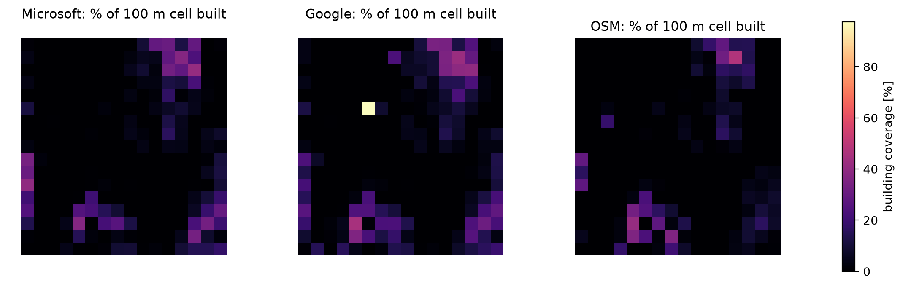
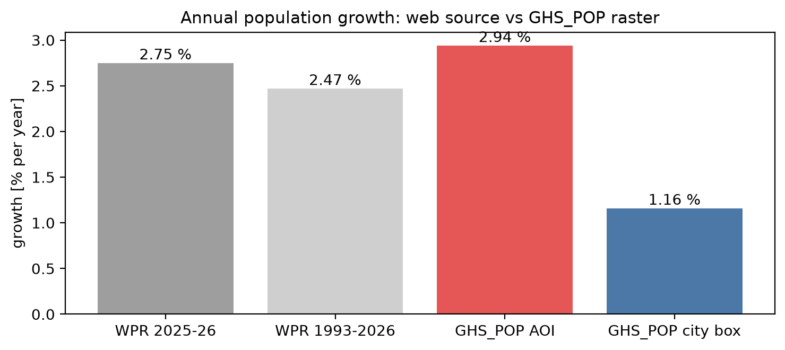
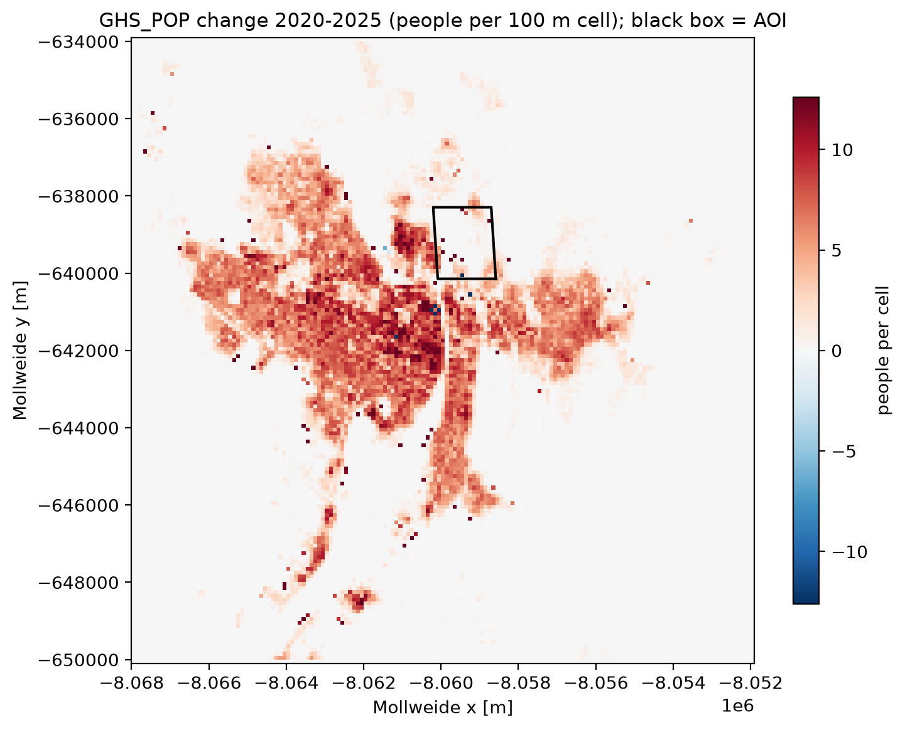
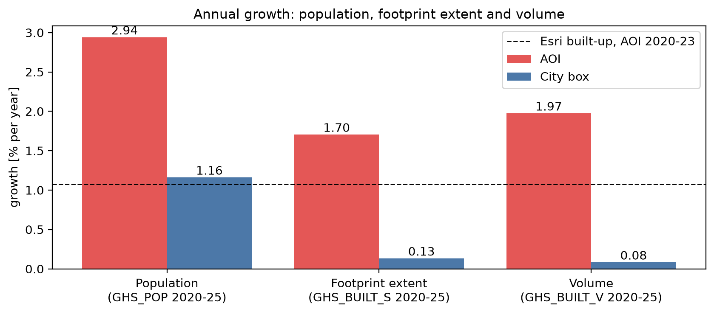
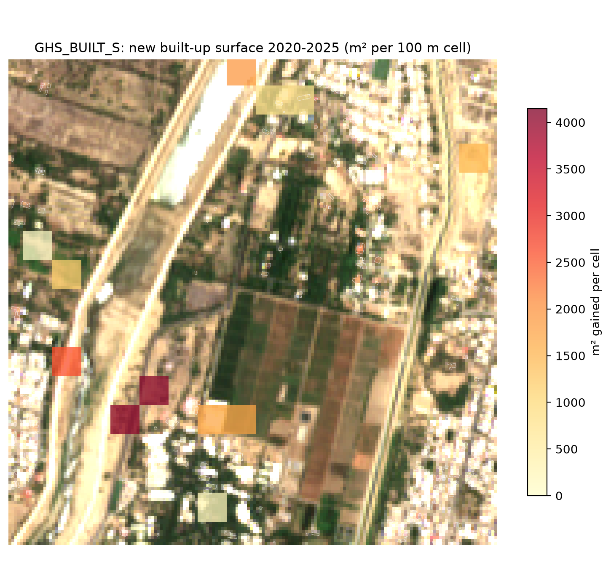
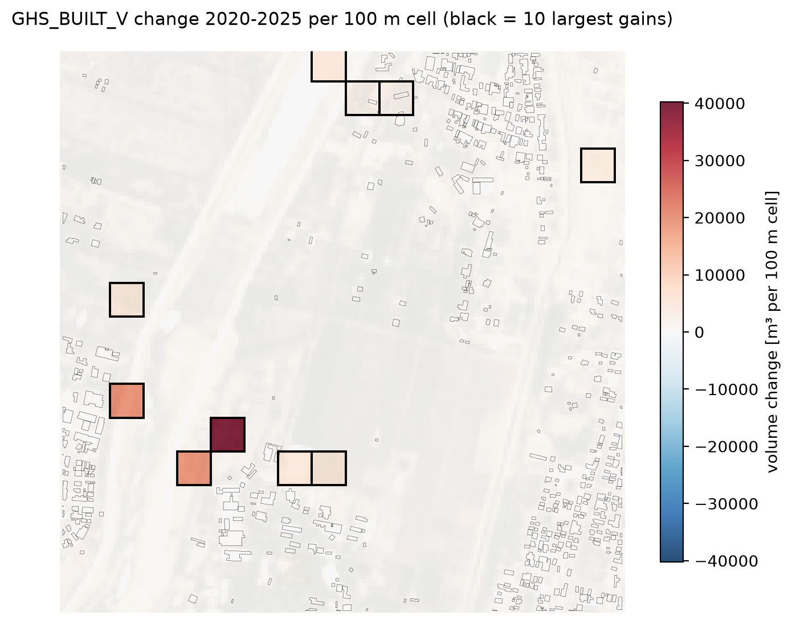

**856.114 GeoHumanitarian Action**

**Homework Assignment 2: Building Footprints and Rasterized Population Data**

Student: Samuel Appiah Kubi · Student ID: [FILL: your student ID]

University of Salzburg, Copernicus Master in Digital Earth

Date: 30.10.2026

Notebook: piura_growth_pygeovision.ipynb (Jupyter) and piura_growth_pygeovision.py (marimo), submitted with this report

# 1. Introduction

World Population Review describes Piura as the fastest growing city in Peru ([Piura Population 2026](https://worldpopulationreview.com/cities/peru/piura)). This report tests that statement for 2020 to 2025 with rasterized population data and building data. It answers four questions:

1. Do the datasets show the same growth rate as the World Population Review source?
2. What is the annual growth rate of building footprint extent?
3. Where is the city growing in extent?
4. Where do we observe growth in building volume?

The analysis runs in a notebook rebuilt from the Session 2 marimo script, available as a marimo file and as a Jupyter notebook. It needs **no Google Earth Engine account**: every dataset comes from an open source.

- **Building footprints** are extracted with **pygeovision 2.2.0** (Appiah Kubi, 2026; [documentation](https://pygeovision.readthedocs.io/en/latest/index.html)), an open-source Python package that reads the Microsoft, Google and OpenStreetMap footprint datasets for a bounding box, measures every polygon in the local UTM zone and returns density rasters and statistics in one call.
- **Built-up change 2020–2023** comes from the Esri 10 m annual land cover through the pygeovision `urban_expansion` pipeline (Microsoft Planetary Computer).
- **The Sentinel-2 image** is searched on the Microsoft Planetary Computer and read with pygeovision’s grid reader.
- **Population, built-up surface and built-up volume for 2020 and 2025** come from the Global Human Settlement Layer (GHSL R2023A), downloaded as 100 m tiles from the JRC open-data server.

**Summary of findings.** In the AOI, GHS_POP population grew 2.94% per year from 2020 to 2025, slightly above the 2.75% on the website, but the city-wide raster rate is only 1.16% per year. Building footprint extent (GHS_BUILT_S) grew 1.70% per year and building volume (GHS_BUILT_V) 1.97% per year in the AOI, against only 0.13% and 0.08% per year for the whole city. The Esri land cover gives about 1.1% per year net growth of built-up area from 2020 to 2023, with a gross gain of 16.8 ha and a gross loss of 11.2 ha. New built-up surface and the largest volume gains concentrate in a few 100 m cells in the south-west of the AOI, around the southern building cluster, and along the Río Piura on its western and northern edges; the dense housing on the eastern edge hardly changes. Growth is mostly horizontal, with a slight increase in mean building height.

# 2. Study Area and Area of Interest

The area of interest (AOI) is a 2.76 km² box (1.66 km × 1.66 km) on the north-eastern edge of the urban area of Piura. Its bounds (EPSG:4326) are west -80.625, south -5.180, east -80.610 and north -5.165.

The AOI sits where irrigated farmland meets residential neighbourhoods, the kind of urban fringe where growth shows first. It covers about 17 × 17 cells of the 100 m GHSL grid. For population and for a city-wide comparison, a second, larger box around the whole city is used (bounds -80.70, -5.26, -80.55, -5.13, about 16.7 km by 14.5 km). Both boxes fall in the same GHSL tile (R10_C10).

Figure 1 shows the AOI (white box) on high-resolution satellite imagery from the notebook’s interactive map, with the Microsoft footprints read by pygeovision in red. The embanked bed of the Río Piura crosses the western part from south-west to north-east, and a narrow irrigation canal runs north–south east of the centre. Gridded fields fill the south-centre, with orchards and trees north of them. The buildings cluster around the edges: a dense block in the north-east, rows of houses along the eastern edge and on the western bank of the river, and a cluster of larger buildings among trees in the south-west, between the river and the fields.

{width=16cm}

# 3. Data and Methods

## 3.1 Datasets

The three footprint datasets are single snapshots: they show what exists but not how it changed. Growth is therefore measured with datasets that use the same method in two or more years: GHSL (2020 and 2025) and the Esri land cover (2020 and 2023).

*Table 1. Datasets used and what each returned for the AOI.*

| Dataset | Type and access (no account) | Used for | Result in the AOI |
|---|---|---|---|
| Microsoft Global ML Building Footprints | Vector polygons, one snapshot; pygeovision building_footprints, source = "microsoft" | Footprint comparison | 604 buildings, 13.83 ha |
| Google Open Buildings v3 | Vector polygons; pygeovision building_footprints, source = "google", confidence ≥ 0.75 | Footprint comparison | 1,141 buildings, 17.27 ha |
| OpenStreetMap | Volunteer-mapped polygons via the Overpass API; pygeovision building_footprints, source = "osm" | Footprint comparison, building types | 321 buildings, 9.68 ha |
| GHSL GHS_POP R2023A | Raster, 100 m, residential population, epochs 2020 and 2025; JRC open-data tiles | Question 1 | +2.94% per year (city box +1.16%) |
| GHSL GHS_BUILT_S R2023A | Raster, 100 m, built-up surface (m² per cell), epochs 2020 and 2025; JRC open-data tiles | Questions 2 and 3 | +1.70% per year (city box +0.13%) |
| GHSL GHS_BUILT_V R2023A | Raster, 100 m, built-up volume (m³ per cell), epochs 2020 and 2025; JRC open-data tiles | Question 4 | +1.97% per year (city box +0.08%) |
| Esri / Impact Observatory 10 m Annual Land Cover v02 | Raster, yearly 2017–2023, built-up class; pygeovision urban_expansion (Planetary Computer) | Questions 2 and 3, independent check | +16.8 ha gained, −11.2 ha lost (2020–2023) |
| Sentinel-2 L2A | 10 m true-colour image; Microsoft Planetary Computer, read with pygeovision | Visual context | Image of 5 October 2026 |

## 3.2 Why pygeovision, and why no Earth Engine

The Session 2 script read Google Open Buildings, Sentinel-2 and GHS_POP through Google Earth Engine, which needs an account and a cloud project. This notebook avoids that.

**Building footprints.** In Session 2 each source needed its own code: a mercantile quadkey lookup for Microsoft, an Earth Engine feature download for Google and osmnx for OSM. pygeovision replaces all three with one call, `client.pipeline("building_footprints", bbox=..., source=...)`. Every run returns the same outputs, which makes the sources directly comparable:

- a GeoPackage (layer `buildings`) with one polygon per building and its area in m², measured in UTM zone 17S;
- `building_density.tif` (share of each 100 m cell covered by buildings) and `building_count.tif`;
- `result.stats` with the count, total footprint area, coverage, mean and median building size, and a note on the data source.

The call does not raise an error when a source cannot be reached; it returns `success=False` with the reason, which the notebook prints as a status table (all three sources returned `success=True`). pygeovision reads the published datasets; it does not detect buildings on our own imagery, which would need a trained network and cannot resolve single houses at 10 m.

**Built-up change and imagery.** pygeovision’s `urban_expansion` pipeline and its Planetary Computer reader (`PlanetaryComputer`, `make_grid`, `read_to_grid`) give the Esri land-cover change and the Sentinel-2 image, both resampled to a fixed grid in UTM 17S.

**Growth over time.** The assignment suggests the Open Buildings 2.5D Temporal dataset, but it is distributed through Earth Engine only. GHSL built-up surface (GHS_BUILT_S) and built-up volume (GHS_BUILT_V) answer the same questions — footprint extent and building volume per 100 m cell — and are free to download. They also cover the assignment period exactly (2020 and 2025), while the 2.5D Temporal dataset ends in 2023.

## 3.3 Workflow in the notebook

The notebook follows the Session 2 structure. The code of the main steps is listed in Appendix A, and the code behind each answer in Appendix B.

1. Set the AOI, the city box, UTM zone 17S (EPSG:32717), World Mollweide (the GHSL grid) and the epochs.
2. Start the pygeovision client and run `building_footprints` once per source (Microsoft, Google, OSM); read each GeoPackage.
3. Search Sentinel-2 L2A on the Planetary Computer for the last 12 months, keep the newest date whose scene classification shows less than 5% cloud, shadow or no data over the AOI (5 October 2026), and read its true-colour bands on a 10 m grid.
4. Compare the three footprint sources on the image, by size distribution, by 100 m density and on an interactive map (saved as `figures/interactive_map.html`).
5. Find the GHSL tile that holds Piura (R10_C10), download GHS_POP, GHS_BUILT_S and GHS_BUILT_V for 2020 and 2025 once, and check that each tile covers the AOI and the city box.
6. Sum each GHSL layer over the AOI and the city box, run pygeovision `urban_expansion` for 2020→2023, and calculate growth rates.
7. Map where built-up surface and volume grew, cell by cell, over the Sentinel-2 image and the footprints.

## 3.4 Calculations

Annual growth rate (compound annual growth rate, n = number of years):

*CAGR = (V*~end~ */ V*~start~*)*^1/n^ *− 1*

- Sums over an area: every GHSL 100 m cell whose centre lies inside the AOI or the city box is summed on its native Mollweide grid.
- Footprint extent = Σ GHS_BUILT_S (m²); building volume = Σ GHS_BUILT_V (m³); n = 5 years (2020–2025).
- Mean building height = volume ÷ footprint extent, so its annual change is (1 + volume growth) ÷ (1 + extent growth) − 1. In the same way, the change in people per square metre of built-up surface is (1 + population growth) ÷ (1 + extent growth) − 1.
- Esri built-up growth: built-up area in 2020 and 2023, n = 3 years, from pygeovision `urban_expansion`, which also maps each 10 m pixel as not built, built in both years, new or lost.
- Maps: GHSL is resampled (nearest neighbour) from Mollweide to a 100 m grid in UTM 17S so it can be drawn over Sentinel-2 and the footprints. Gain = 2025 − 2020 per cell.

# 4. Results and Discussion

## 4.1 Building footprints from pygeovision

The three sources disagree strongly on how many buildings the AOI contains: 321 (OSM), 604 (Microsoft) and 1,141 (Google). Table 2 gives the statistics pygeovision returned for each run, and Figure 2 shows the polygons on the same Sentinel-2 image.

*Table 2. pygeovision building_footprints statistics per source.*

| Source | Buildings | Footprint area (ha) | Coverage of AOI (%) | Buildings per km² | Mean size (m²) | Median size (m²) |
|---|---|---|---|---|---|---|
| Microsoft | 604 | 13.83 | 5.0 | 219 | 228.9 | 141.0 |
| Google (conf. ≥ 0.75) | 1,141 | 17.27 | 6.3 | 414 | 151.4 | 95.4 |
| OpenStreetMap | 321 | 9.68 | 3.5 | 116 | 301.5 | 177.0 |

{width=16cm}

OSM is clearly incomplete: it maps the main clusters but far fewer of the small houses on the edges than Microsoft and Google. Almost all of its buildings carry the generic tag “yes”; about 30 are tagged “university”, and only a handful “house”, “roof”, “residential” or “chapel”. Microsoft and Google both outline the small houses on the north-eastern, western and south-eastern edges.

Google returns almost twice as many polygons as Microsoft, and the size distribution in Figure 3 shows why: Google’s median footprint is 95 m² against 141 m² for Microsoft and 177 m² for OSM, and it has many more buildings below 50 m². Google splits rows of attached houses into single units and also keeps small sheds, where Microsoft and OSM outline larger blocks. As a result, the total footprint area differs much less between the sources (9.7 to 17.3 ha) than the counts do (321 to 1,141). Google also contains a few long, thin polygons along the river embankment that are not buildings (Figure 2, centre).

{width=12cm}

The pygeovision density rasters (Figure 4) put the densest building cover in the same 100 m cells for all three sources: the north-eastern block (up to about 45% of the cell built), the southern cluster (about 45%) and the western and south-eastern edges (30–40%). The central farmland has almost no buildings in any source. The single very bright Google cell (about 95%) in the west-centre is an artefact: pygeovision assigns each building to the cell holding its centroid, so a long polygon on the river embankment puts its whole area into one cell. Because the datasets differ so much, absolute counts are not compared across sources; growth is measured within datasets that use one method for every year (Sections 4.3 to 4.5).

{width=16cm}

## 4.2 Question 1: Do the datasets show the same growth rate as the source?

The World Population Review page estimates the 2026 population of Piura at 609,909, up from 272,231 in 1993. It reports growth of 16,348 in the last year, an annual change of 2.75%. Working backwards, the 2025 population is 593,561, and the average growth from 1993 to 2026 is 2.47% per year. The page says its values come from the 1993–2017 census series, a 2022 projection and its own projections, so the figures after 2017 are modelled.

From the rasterized data, GHS_POP gives the population for 2020 and 2025 in the AOI and in the city box (Table 3, Figure 5).

*Table 3. Population growth rates from the web source and from the GHS_POP raster.*

| Measure | Period | Annual growth |
|---|---|---|
| World Population Review, whole city (593,561 → 609,909) | 2025–2026 (one year) | 2.75% |
| World Population Review, whole city (272,231 → 609,909) | 1993–2026 (average) | 2.47% |
| GHS_POP, AOI | 2020–2025 (CAGR) | 2.94% |
| GHS_POP, city box | 2020–2025 (CAGR) | 1.16% |

{width=13cm}

**Answer: only partly.** In the AOI the raster growth rate (2.94% per year) is close to, and slightly above, the 2.75% on the website. For the city as a whole it is not: the GHS_POP city box grows at only 1.16% per year, less than half the website figure.

Several things explain the gap. The website rate is a single-year figure from modelled projections, while the raster rate is a five-year average. The city box is a rectangle and may not match the area the website counts as Piura. The 2025 GHS_POP layer is itself a projection and may smooth local growth.

Figure 6 shows where GHS_POP places the change. Population grows almost everywhere in the built-up city, most strongly in the dense central and western districts, along the southern corridor and in the neighbourhood directly west of the AOI. Only a few isolated cells near the centre lose people. Inside the AOI, which is mostly farmland, only a handful of cells change, but from a small base, so the relative growth is high. The AOI is on the urban edge, so its match with the website figure suggests that the headline 2.75% reflects growth at the fringe rather than the city as a whole. This analysis cannot confirm that Piura is the fastest growing city in Peru, because other cities were not compared.

{width=13cm}

## 4.3 Question 2: What is the annual growth rate of building footprint extent?

Footprint extent was measured as the GHS_BUILT_S built-up surface summed over the AOI and the city box for 2020 and 2025, and building volume as the GHS_BUILT_V sum. Table 4 gives the annual growth rates and the changes in mean building height and in people per square metre of built-up surface that follow from them.

*Table 4. Annual growth 2020–2025 from GHSL, and the changes that follow from it.*

| Area | Population (% per year) | Footprint extent (% per year) | Volume (% per year) | Mean building height, 2020→2025 | People per m² built-up, 2020→2025 |
|---|---|---|---|---|---|
| AOI | 2.94 | 1.70 | 1.97 | +1.3% | +6.2% |
| City box | 1.16 | 0.13 | 0.08 | −0.25% | +5.3% |

**Answer:** building footprint extent in the AOI grew by **1.70% per year** between 2020 and 2025 (GHS_BUILT_S), more than ten times the rate of the whole city box (0.13% per year). Population in the AOI grew faster still (2.94% per year), so the model places about 6% more people on each square metre of built-up land in 2025 than in 2020; the same holds city-wide (+5.3%), where population grows by 1.16% per year on an almost unchanged built-up surface. Both GHSL layers are modelled, and GHS_POP distributes census population over the built-up volume, so this comparison shows the model’s logic as much as the ground truth.

A second, independent estimate comes from pygeovision `urban_expansion`, which compares the built-up class of the Esri 10 m annual land cover in 2020 and 2023. It gives a gross gain of 16.8 ha and a gross loss of 11.2 ha, a net gain of 5.6 ha and an annual growth of about 1.1% (dashed line in Figure 7). The gross loss is two-thirds of the gross gain, and the change map labels fields as built-up and the river corridor as new built-up when compared with the high-resolution imagery in Figure 1. This points to classifier disagreement between the two years rather than real new building or demolition, so the Esri rate is only a weak, independent check, not a precise measurement.

{width=14cm}

## 4.4 Question 3: Where is the city growing in extent?

Figure 8 maps the new built-up surface 2020–2025 from GHSL on the Sentinel-2 image.

{width=13cm}

**Answer:** in GHSL, new built-up surface appears in only about a dozen of the AOI’s 100 m cells, and it is concentrated in three places:

- **South-west**, around the southern building cluster west of the farmland: the two cells with the largest gains in the AOI (about 3,500–4,100 m² each), plus two cells with about 1,800 m² at the south-western corner of the farmland and a smaller gain further south.
- **The western edge, on the far bank of the Río Piura**: one cell with about 3,000 m² and two smaller gains (about 600–1,300 m²) further north.
- **The northern edge and the north-east**: one cell of about 2,000 m² beside the river at the top of the AOI, two smaller cells next to it, and one cell of about 1,600 m² on the eastern edge.

The dense housing on the eastern and south-eastern edges and the north-eastern block show almost no new built-up surface: GHSL already counts them as built in 2020. The central farmland shows none. In this model the AOI therefore grows by filling gaps and extending the existing clusters at the south-west and along the river, not by building on the farmland or creating new isolated settlements.

The notebook also maps the Esri 10 m built-up change from pygeovision `urban_expansion`, but it is not shown here. Compared with the high-resolution imagery, it labels fields in the north-west as built-up and places most of its new built-up area along the river corridor, so it is not reliable for locating growth in this fringe at 10 m.

## 4.5 Question 4: Where do we observe growth in building volume?

Building volume (GHS_BUILT_V) grew by **1.97% per year** in the AOI from 2020 to 2025, slightly faster than the footprint extent (1.70% per year). Because volume is surface times height, the mean building height in the AOI rose by 0.27% per year, or 1.3% over the five years (Table 4). In the city box, volume (0.08% per year) grew slightly more slowly than surface (0.13% per year), so the mean height there fell by 0.25%, which is practically unchanged. Growth in the AOI is therefore mainly horizontal, with a small vertical component such as added floors on existing houses.

Figure 9 shows the change in volume per 100 m cell over the Sentinel-2 image, with the ten largest gains outlined in black.

{width=13cm}

**Answer:** the volume gains are in the same places as the new built-up surface, and they are even more concentrated. One cell in the south-west, beside the southern building cluster, gains about 40,000 m³, far more than any other. Two cells gain about 20,000 m³: one on the western edge across the river and one in the south-west. The remaining outlined cells gain less than about 10,000 m³ each: three at the northern edge beside the river, one on the eastern edge in the north-east, one on the western edge and two at the south-western corner of the farmland. No cell shows a visible loss of volume, and the dense eastern housing and the farmland do not change.

# 5. Limitations

- GHSL epochs are interpolated or extrapolated in 5-year steps from satellite observations (a Sentinel-2 composite and Landsat). The 2025 values of GHS_POP, GHS_BUILT_S and GHS_BUILT_V are therefore modelled, not observed, and changes between 2020 and 2025 are smooth by construction. This likely explains why only about a dozen AOI cells change and why the city-wide built-up surface hardly grows.
- GHS_POP distributes census population over the residential built-up volume, so population growth and built-up growth from GHSL are not independent measures.
- GHSL is a 100 m grid; the AOI holds only about 17 × 17 cells, so the maps show where growth happens at block level, not for single buildings. Resampling from Mollweide to UTM shifts cell edges by up to half a cell in the maps (not in the sums).
- The Esri land cover ends in 2023, so its growth covers 2020–2023 only. Each year is classified independently and generalised to large patches; compared with high-resolution imagery it misclassifies fields and the river corridor, so it is used only as a rough check and its map is not shown.
- The Open Buildings 2.5D Temporal dataset suggested in the assignment was not used because it is distributed only through Google Earth Engine.
- The pygeovision footprint sources are single snapshots of different dates and cannot show growth. Their counts differ by a factor of 3.5 (Table 2). pygeovision reads OSM buildings from closed ways only; buildings mapped as multipolygon relations are missing.
- The website figures after 2017 are projections too.
- The AOI is 2.76 km² on the urban fringe. Its results describe this location and do not represent all of Piura.

# 6. Conclusion

The population and building data show that the north-eastern fringe of Piura is growing faster than the city as a whole. In the AOI, population rose 2.94% per year (GHS_POP, 2020–2025), building footprint extent 1.70% per year (GHS_BUILT_S) and building volume 1.97% per year (GHS_BUILT_V); for the whole city the rates are 1.16%, 0.13% and 0.08% per year. The website’s 2.75% is matched only at the fringe, not city-wide. Growth in extent and volume concentrates in a few blocks in the south-west of the AOI around the southern building cluster and along the Río Piura on the western and northern edges, as infill and extension of existing clusters; the farmland and the dense eastern housing do not change. Volume grows slightly faster than footprint, so growth is mostly horizontal with a small vertical component. The Esri land cover adds a net gain of 5.6 ha (2020–2023), but its large gross loss shows it is not reliable at this scale. The whole workflow ran without an Earth Engine account: pygeovision returned comparable footprints, areas, densities and statistics from one call per source, plus the land-cover change and the satellite image, and the GHSL layers came straight from the JRC server. Table 5 summarises the answers.

*Table 5. Summary of answers.*

| Question | Answer |
|---|---|
| 1. Same growth rate as the source? | Partly. AOI 2.94% per year, close to 2.75% on the website; city box 1.16% per year, less than half the website rate. |
| 2. Annual growth of footprint extent | 1.70% per year in the AOI (GHS_BUILT_S, 2020–2025), 0.13% per year city-wide; Esri built-up about 1.1% per year net (2020–2023), with large gross gain and loss. |
| 3. Where is the city growing in extent? | South-west of the AOI around the southern building cluster, and along the Río Piura on the western and northern edges; infill and extension of existing clusters, nothing on the farmland. |
| 4. Where does building volume grow? | Same places, most of all one block in the south-west (about 40,000 m³); volume 1.97% per year, slightly faster than footprint, so growth is mostly horizontal. |

# Appendix A: Notebook Code of the Main Steps

The listings below are the cells of the notebook (`piura_growth_pygeovision.ipynb`) that produce the data; the figures in Section 4 are their outputs.

**A1. Study settings (AOI, city box, coordinate systems, epochs)**

{{CODE:settings}}

**A2. Building footprints with pygeovision (one run per source)**

{{CODE:footprints}}

**A3. Sentinel-2 from the Planetary Computer: newest date that is cloud-free over the AOI**

{{CODE:s2}}

**A4. GHSL tile download from the JRC open-data server**

{{CODE:ghsl}}

**A5. GHSL sums over a polygon**

{{CODE:ghslsum}}

# Appendix B: Notebook Code Used for the Answers

**B1. Question 1: GHS_POP sums and growth rates**

{{CODE:pop}}

**B2. Question 2: GHS_BUILT_S and GHS_BUILT_V sums and growth rates**

{{CODE:built}}

**B3. Question 2 and 3: Esri built-up change with pygeovision**

{{CODE:ue}}

**B4. Question 3: GHSL surface and volume on a 100 m grid for the maps**

{{CODE:grid}}

**B5. Question 4: map of the volume change**

{{CODE:volmap}}

# References

Appiah Kubi, S. (2026). *pygeovision: A Unified Open-Source Python Platform for Satellite Earth Observation AI* (Version 2.1.9) [Software]. Zenodo. https://doi.org/10.5281/zenodo.22258220

Boeing, G. (2017). OSMnx: New methods for acquiring, constructing, analyzing, and visualizing complex street networks. *Computers, Environment and Urban Systems, 65*, 126–139. https://doi.org/10.1016/j.compenvurbsys.2017.05.004

Drusch, M., Del Bello, U., Carlier, S., Colin, O., Fernandez, V., Gascon, F., Hoersch, B., Isola, C., Laberinti, P., Martimort, P., Meygret, A., Spoto, F., Sy, O., Marchese, F., & Bargellini, P. (2012). Sentinel-2: ESA's optical high-resolution mission for GMES operational services. *Remote Sensing of Environment, 120*, 25–36. https://doi.org/10.1016/j.rse.2011.11.026

Jordahl, K., Van den Bossche, J., Fleischmann, M., Wasserman, J., McBride, J., Gerard, J., et al. (2020). geopandas/geopandas: v0.8.1 [Software]. Zenodo. https://doi.org/10.5281/zenodo.3946761

Karra, K., Kontgis, C., Statman-Weil, Z., Mazzariello, J. C., Mathis, M., & Brumby, S. P. (2021). Global land use/land cover with Sentinel-2 and deep learning. *IGARSS 2021*, 4704–4707.

marimo. (n.d.). marimo: A reactive Python notebook. https://marimo.io

Microsoft. (2026). Global ML Building Footprints [Data set]. GitHub. https://github.com/microsoft/GlobalMLBuildingFootprints

Esri. (n.d.). World Imagery [Basemap]. https://server.arcgisonline.com/ArcGIS/rest/services/World_Imagery/MapServer

Microsoft. (n.d.). Microsoft Planetary Computer [Data catalogue]. https://planetarycomputer.microsoft.com

OpenStreetMap contributors. (2026). OpenStreetMap [Data set]. https://www.openstreetmap.org

Pesaresi, M., & Politis, P. (2023). GHS-BUILT-S R2023A - GHS built-up surface grid, derived from Sentinel2 composite and Landsat, multitemporal (1975-2030) [Data set]. European Commission, Joint Research Centre. https://doi.org/10.2905/9F06F36F-4B11-47EC-ABB0-4F8B7B1D72EA

Pesaresi, M., & Politis, P. (2023). GHS-BUILT-V R2023A - GHS built-up volume grids derived from joint assessment of Sentinel2, Landsat, and global DEM data, multitemporal (1975-2030) [Data set]. European Commission, Joint Research Centre. https://doi.org/10.2905/AB2F107A-03CD-47A3-85E5-139D8EC63283

Pesaresi, M., Schiavina, M., Politis, P., Freire, S., Krasnodębska, K., Uhl, J. H., Carioli, A., et al. (2024). Advances on the Global Human Settlement Layer by joint assessment of Earth observation and population survey data. *International Journal of Digital Earth, 17*(1). https://doi.org/10.1080/17538947.2024.2390454

Schiavina, M., Freire, S., Carioli, A., & MacManus, K. (2023). GHS-POP R2023A: GHS population grid multitemporal (1975–2030) [Data set]. European Commission, Joint Research Centre. https://doi.org/10.2905/2FF68A52-5B5B-4A22-8F40-C41DA8332CFE

Sirko, W., Kashubin, S., Ritter, M., Annkah, A., Bouchareb, Y. S. E., Dauphin, Y., Keysers, D., Neumann, M., Cisse, M., & Quinn, J. (2021). Continental-scale building detection from high resolution satellite imagery. arXiv. https://arxiv.org/abs/2107.12283

World Population Review. (2026). Piura Population 2026. https://worldpopulationreview.com/cities/peru/piura
